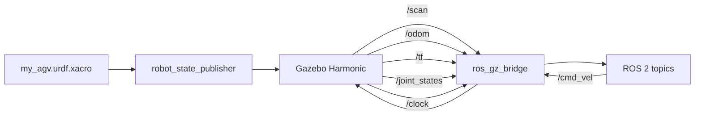

# AGV

A differential-drive AGV in ROS 2 Jazzy and Gazebo Harmonic. Red box chassis with four wheels, a 2D lidar on top, and a diff-drive plugin. I built this to learn how URDF, ros\_gz\_bridge and the diff-drive plugin fit together before working on the fleet simulation project.

## Robot

From `urdf/my_agv.urdf.xacro`:

| | |
|---|---|
| Chassis | 0.40 m × 0.30 m × 0.10 m, 1 kg |
| Wheel radius | 0.08 m, width 0.04 m, 2 kg each |
| Wheelbase (drive axle) | 0.36 m |
| Lidar | 360° GPU lidar, 10 Hz, 0.2–12 m range, mounted 0.15 m above the chassis |

Drive wheels are rear. Front wheels have zero friction so they don't fight the diff-drive.

## What's in here

```
urdf/my_agv.urdf.xacro        robot description
worlds/my_warehouse.sdf        warehouse with shelves and buckets from Gazebo Fuel
worlds/warehouse.sdf           plain empty warehouse
worlds/test.sdf                minimal test world
launch/display.launch.py       robot in RViz2 with joint state GUI
launch/gazebo.launch.py        robot in Gazebo (empty world)
launch/my_warehouse.launch.py  robot in my_warehouse.sdf
rviz/my_agv.rviz               RViz config for the robot model
rviz/my_mapping.rviz           RViz config for lidar + odom
CMakeLists.txt / package.xml   ROS 2 package (name: my_agv_description)
```

## System diagram



## Running it

```bash
# clone and build
mkdir -p ~/agv_ws/src && cd ~/agv_ws/src
git clone https://github.com/MaharajLMR/AGV.git .
cd ~/agv_ws && colcon build && source install/setup.bash

# visualise in RViz (no Gazebo needed)
ros2 launch my_agv_description display.launch.py

# spawn in Gazebo with the warehouse world
ros2 launch my_agv_description my_warehouse.launch.py
```

Drive it after the sim is up:

```bash
ros2 topic pub /cmd_vel geometry_msgs/msg/Twist \
  "{linear: {x: 0.3}, angular: {z: 0.5}}" --once
```

Watch the lidar:

```bash
ros2 topic echo /scan --field ranges | head
```

## Bridges (ros\_gz\_bridge topics)

| Topic | Type | Direction |
|---|---|---|
| `/clock` | `rosgraph_msgs/msg/Clock` | GZ → ROS |
| `/cmd_vel` | `geometry_msgs/msg/Twist` | ROS → GZ |
| `/odom` | `nav_msgs/msg/Odometry` | GZ → ROS |
| `/scan` | `sensor_msgs/msg/LaserScan` | GZ → ROS |
| `/tf` | `tf2_msgs/msg/TFMessage` | GZ → ROS |
| `/joint_states` | `sensor_msgs/msg/JointState` | GZ → ROS |

## Dependencies

ROS 2 Jazzy, Gazebo Harmonic (gz-sim 8), `ros_gz_sim`, `ros_gz_bridge`, `robot_state_publisher`, `joint_state_publisher_gui`, `xacro`.
