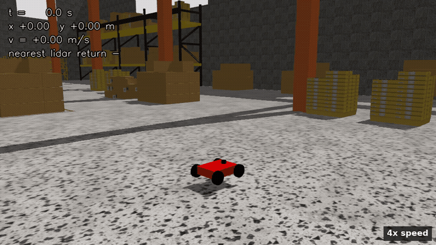
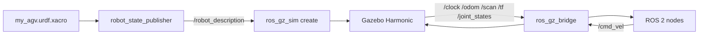

# AGV

[](https://github.com/MaharajLMR/AGV/actions/workflows/ci.yml)

A differential-drive AGV in ROS 2 Jazzy and Gazebo Harmonic: red box chassis, four wheels, a 2D lidar on top. I built it to learn how URDF, `ros_gz_bridge` and the diff-drive plugin fit together before starting the fleet simulation project.



The clip is sped up 4x. Longer version with a top-down view: [docs/agv_demo.mp4](docs/agv_demo.mp4). The numbers in the corner are read live off `/odom` and `/scan` while it drives, not typed in.

## Robot

From `urdf/my_agv.urdf.xacro`:

| | |
|---|---|
| Chassis | 0.40 m × 0.30 m × 0.10 m, 1 kg |
| Wheel radius | 0.08 m, width 0.04 m, 2 kg each |
| Wheelbase (drive axle) | 0.36 m |
| Lidar | 360° GPU lidar, 10 Hz, 0.2–12 m range, 0.15 m above the chassis |

Drive wheels are at the rear. The front wheels have zero friction so they don't fight the diff-drive plugin, which is a shortcut: a real AGV would have castors.

## Two things that were wrong

Both only showed up once I recorded a run and put the live topic values on screen.

The lidar was mounted with `rpy="0 -0.26 0"`, so the whole 360° scan plane sat at 15°. One side of the ring hit the floor about 0.94 m ahead, and since that was always the closest thing, `min(ranges)` was 0.94 m no matter where the robot was. The scan was useless for seeing obstacles. The joint is level now and the same run reports returns from 3.2 m to 6 m.

`/clock` was bridged with `@`, which is both directions, and the bridge picked ROS to Gazebo. Nothing on the ROS side ever received sim time, so every node was quietly running on wall clock. The bridge entries are explicit now: `[` for Gazebo to ROS, `]` for ROS to Gazebo.

## What's in here

```
urdf/my_agv.urdf.xacro         robot description
worlds/my_warehouse.sdf        warehouse with shelves and buckets from Gazebo Fuel
worlds/warehouse.sdf           plain empty warehouse
worlds/test.sdf                minimal test world
launch/display.launch.py       robot in RViz2 with the joint state GUI
launch/gazebo.launch.py        robot in the small test world
launch/my_warehouse.launch.py  robot in my_warehouse.sdf, headless:=true to skip the GUI
rviz/my_agv.rviz               RViz config for the robot model
rviz/my_mapping.rviz           RViz config for lidar + odom
tools/run_demo.sh              record one demo run headless
tools/drive_demo.py            drives the square, closed loop on /odom
tools/record_demo.py           saves the demo cameras to PNG frames
tools/make_demo_video.sh       frames to mp4 + gif
tests/                         pytest checks, no simulator needed
CMakeLists.txt / package.xml   ROS 2 package (name: my_agv_description)
```

## How it fits together



## Running it

```bash
mkdir -p ~/agv_ws/src && cd ~/agv_ws/src
git clone https://github.com/MaharajLMR/AGV.git .
cd ~/agv_ws && colcon build && source install/setup.bash

# robot in RViz, no Gazebo needed
ros2 launch my_agv_description display.launch.py

# robot in the warehouse
ros2 launch my_agv_description my_warehouse.launch.py
```

Drive it once the sim is up:

```bash
ros2 topic pub /cmd_vel geometry_msgs/msg/Twist \
  "{linear: {x: 0.3}, angular: {z: 0.5}}" --once
```

Watch the lidar:

```bash
ros2 topic echo /scan --field ranges | head
```

## Recording the demo again

The warehouse world carries two fixed cameras that only the recorder reads. One run takes about ten minutes on my laptop because headless rendering is slow.

```bash
tools/run_demo.sh /tmp/agvrun
tools/make_demo_video.sh /tmp/agvrun docs/agv_demo
```

The run above covered 15.0 m in 49.9 s of sim time and the closest lidar return was 3.22 m.

## Bridged topics

| Topic | Type | Direction |
|---|---|---|
| `/clock` | `rosgraph_msgs/msg/Clock` | Gazebo → ROS |
| `/cmd_vel` | `geometry_msgs/msg/Twist` | ROS → Gazebo |
| `/odom` | `nav_msgs/msg/Odometry` | Gazebo → ROS |
| `/scan` | `sensor_msgs/msg/LaserScan` | Gazebo → ROS |
| `/tf` | `tf2_msgs/msg/TFMessage` | Gazebo → ROS |
| `/joint_states` | `sensor_msgs/msg/JointState` | Gazebo → ROS |

## Tests

`python3 -m pytest tests` needs no simulator. It builds the URDF with `xacro` and checks the links, that the drive wheels turn, and that the wheel separation in the joints matches the one the diff-drive plugin is told. Two of them are there because of the bugs above: one fails if the lidar joint is tilted again, one fails if a bridge entry points the wrong way. CI runs the same thing plus `check_urdf` on every push.

## Dependencies

ROS 2 Jazzy, Gazebo Harmonic (gz-sim 8), `ros_gz_sim`, `ros_gz_bridge`, `robot_state_publisher`, `joint_state_publisher_gui`, `xacro`. The recording scripts also need `opencv-python`, the `gz-transport` Python bindings and `ffmpeg`.

## Licence

MIT, see [LICENSE](LICENSE).
